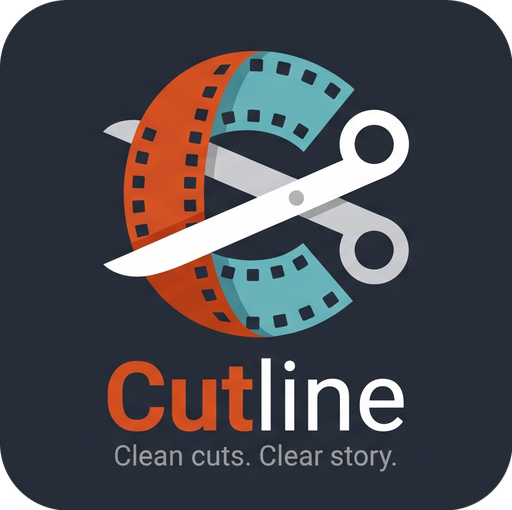

<p align="center"></p>

# Cutline

**Clean cuts. Clear story.**

A local Windows app (Gradio) that cleans up a folder of images and arranges them like a storyboard.

1. **Duplicates**: finds exact and near-duplicate photos, keeps the best copy, and sends the rest to the Recycle Bin.
2. **Storyboard**: sorts images by what they *show*, not by file name or date, so the sequence flows from first shot to last.

Everything runs on your PC. Cloud AI is optional and off by default.

## Quick start (Windows)

1. Install [Python 3.10+](https://www.python.org/downloads/) (tick "Add Python to PATH").
2. *(NVIDIA GPU users)* Install the CUDA build of PyTorch first. Get the exact command from <https://pytorch.org>.
3. Double-click **`run.bat`**. It creates a virtual environment and installs everything, including `open_clip_torch`, and it installs the CUDA build of PyTorch if it finds an NVIDIA GPU. It re-installs automatically whenever `requirements.txt` changes, so later updates just work. (Open `run.bat` to change the PyTorch download source if your driver is older.)
4. Your browser opens at `http://127.0.0.1:7860`.

Manual install:

```bash
python -m venv .venv
.venv\Scripts\activate
pip install -r requirements.txt
python app.py
```

## How to use

**1 · Duplicates**
1. Paste the folder path or click **Browse…**, set the similarity tolerance, click **Scan**.
2. Each group shows thumbnails. The highest-resolution copy is marked KEEP, the others DELETE. Click a card to switch it between Keep and Delete.
3. Press **Space** for a full-size preview, or **C** (or the **Compare** button) for an A/B slider in the side panel.
4. The bar at the bottom of the panel shows how many files are marked and has the **Move N to Recycle Bin** button (and **Reset marks**).
   Cutline never deletes permanently and refuses to remove every copy in a group.

**2 · Storyboard**
1. Paste the folder path or click **Browse…**. **All images load immediately** in name order. You do not have to sort first.
2. Arrange them yourself by dragging (select several with Ctrl/Shift+click to move them together), or press **Sort**.
3. **Pin frames** with the lock icon on a frame (or **Pin ends**, **Lock selected**, **Unlock all**). Sorting then works *around* the pinned frames. Pin your first and last frame and Cutline finds the smoothest path between them, so the story starts and ends where you want. Pinned frames keep their current positions.
4. With an AI engine (Ollama, Gemini, ...) a **Story prompt** box appears. Describe the story you want and the AI uses it to decide the order.
5. **Apply order** either copies the images into `_storyboard/` as `001_`, `002_`, ... or renames the originals, then shows a confirmation popup. **Undo** steps back and **Reverse** flips the sequence.
6. The vision model downloads automatically the first time (with a progress bar) and is cached in `~/.cutline/models` (change with `CUTLINE_MODELS`).

**3 · Animatic**
Every image of the storyboard, in order, with a text box beside it. **Generate story** asks the AI engine you chose on the Storyboard tab (it needs an AI engine, not Local only) to write one or two sentences per shot, guided by your story prompt. **Fill empty** only writes the boxes you left empty, **Regenerate** redoes a single shot, and everything is editable. Set the seconds per frame to see the total runtime, then **Export story** writes `animatic.md` and `animatic.csv` into the `_storyboard` folder.

**Layout and shortcuts**
The window itself never scrolls: the header, tabs and footer stay put, the gallery has a single vertical scrollbar, and the left sidebar only scrolls inside itself if your window is too short for it. The **Hide sidebar** button at the top of the sidebar gives the gallery the full width (a **Show sidebar** button then appears in the gallery toolbar). Thumbnails keep each image's own shape, so portrait photos stay portrait. Cutline starts in dark mode; the sun / moon icon at the top right switches themes, and the two icons in the footer check for updates and open About.

| Key | Action |
|---|---|
| **Space** or double-click | Full-size preview in the right-hand panel (hover an image first) |
| **← →** | Previous / next image while the preview is open |
| **C** | Compare the hovered duplicate with the group's KEEP copy (A/B slider) |
| **L** | Lock / unlock the selected storyboard frames |
| **Ctrl+A**, **Esc** | Select all frames, clear the selection (or close the panel) |

## Supported image types

JPG/JPEG, JFIF, PNG, WebP, BMP, GIF, TIFF, **AVIF, HEIC/HEIF** (via `pillow-heif`, included in `requirements.txt`) and JPEG XL (optional: `pip install pillow-jxl-plugin`). If a folder contains a type your install cannot open, Cutline tells you which one was skipped and how to add it.

## Updates and About

* The footer shows the version and **build number** (the git commit count when you installed with `git clone`, otherwise the number stored in `cutline/__init__.py`), plus the commit id.
* **Check for updates**: for a git install it runs `git fetch` (no GitHub API, so no rate limit); for a zip install it reads `cutline/__init__.py` from GitHub. If a newer version exists, an **Update now** button runs `git pull --ff-only`; then close Cutline and run `run.bat` again (it installs any new packages). Zip installs get links to the latest download instead. A small "Update available" badge appears in the footer after startup (the answer is cached for 6 hours). Set `CUTLINE_NO_UPDATE_CHECK=1` to turn the startup check off. Only GitHub is contacted, and only for this.
* **About** shows the app, the author and a Buy Me a Coffee link.
* Set your repository, name, profile link and Buy Me a Coffee page in **`cutline/config.py`**. The coffee button stays hidden until you add the link.

## Sorting engines

| Engine | Needs | Leaves your PC? |
|---|---|---|
| **Local only (CLIP, offline)** | nothing | No |
| **Ollama (local vision model)** | [Ollama](https://ollama.com) running, plus a vision model, e.g. `ollama pull qwen2.5vl:7b`. When you pick this engine, Cutline lists the models installed in your Ollama (vision models first); use **Refresh Ollama models** after pulling a new one. A custom address is read from `OLLAMA_HOST`. | No |
| **Gemini** | API key from Google AI Studio (has a free tier) | Yes |
| **OpenAI** | API key (billed separately from ChatGPT subscriptions) | Yes |
| **Claude** | Anthropic API key | Yes |
| **OpenRouter** | one key, many models | Yes |

* Local mode orders images by visual similarity (smooth flow). The AI engines look at the pictures and also fix story logic, such as establishing shots before close-ups.
* There is no limit on the number of images. Small folders are sent to the model in one request (512 px copies). Bigger folders (more than 12 for Ollama, 100 for cloud engines) use two steps: the model describes the images a few at a time, then orders the descriptions as text. It is slower, and the second step sees descriptions rather than pictures. Ollama requests use an 8192-token context; set `CUTLINE_OLLAMA_CTX` to change it.
* Keys are used for the request only; they are never saved or logged. You can prefill them with the environment variables `GEMINI_API_KEY`, `OPENAI_API_KEY`, `ANTHROPIC_API_KEY` and `OPENROUTER_API_KEY`.
* Model names change often, so each engine has an editable **Model name** field. If a default is outdated, type a current one. Check each provider's terms and data policy, especially for free tiers.

### NSFW mode

Tick **My photos contain NSFW content** to disable every cloud engine (see below). A **Blur thumbnails** checkbox then appears: it blurs all thumbnails in the storyboard, duplicate and animatic views, and a thumbnail un-blurs while you hover over it. The full-size preview panel is not blurred.

Tick **My photos contain NSFW content** to disable every cloud engine. Only *Local* and *Ollama* remain, so nothing leaves your PC. Duplicate detection and CLIP sorting always run locally and work on any content; CLIP-style models do not filter images.

## Vision models

| Model | Download (approx.) | Notes |
|---|---|---|
| CLIP ViT-B/32 (default) | 0.6 GB | Fast, good all-rounder |
| CLIP ViT-L/14 | 1.7 GB | More precise, slower |
| SigLIP ViT-B/16 | 0.8 GB | Strong alternative |
| DINOv2 base | 0.4 GB | Best for shots of the same scene (renders, camera moves). needs `transformers` (included in `requirements.txt`) |

Sizes are estimates.

## How it works

* **Duplicates:** SHA-256 for exact copies; a 256-bit difference hash (brightness structure) plus a colour check for near-duplicates such as resized or recompressed versions. The tolerance slider sets how many hash bits may differ. Heavy crops and rotations can be missed.
* **Storyboard:** the vision model turns each image into a vector; an 8×8 colour thumbnail adds lighting/colour continuity. Cutline then searches for the shortest path through all images (nearest-neighbour from many starts, improved with 2-opt), so every shot sits beside its most similar neighbours.

## Project layout

```
app.py              Gradio interface (3 tabs: Duplicates, Storyboard, Animatic)
assets/             logo, logo mark, favicon
cutline/
  gridhtml.py       HTML for the storyboard, duplicates, animatic and preview panels
  static/           style.css (layout) and dnd.js (drag and drop, locks, preview panel, shortcuts)
  dedupe.py         duplicate detection
  ordering.py       storyboard ordering
  models.py         vision models: first-use download with progress
  providers.py      optional AI engines (Gemini, OpenAI, Claude, OpenRouter, Ollama): ordering + story text
  updater.py        build number, update check, git pull
  files.py          listing, thumbnails, Recycle Bin, applying the order
tests/test_core.py  core tests (no GPU or network needed)
tests/ui_smoke.py   optional browser test of the page script (pip install playwright, then: playwright install chromium)
run.bat             Windows launcher
```

Run the tests with `pip install pytest` then `python -m pytest`.

## Changelog

### 0.6.0
* **Favicon** is now the Cutline logo (set by the page itself, replacing Gradio's default icon).
* **Hide sidebar** button moved to the top of the sidebar; the toolbar shows **Show sidebar** only while it is hidden.
* **Thumbnails keep their original shape** (no more cropping to one shape) in the storyboard, duplicate cards and animatic.
* **Theme, check-for-updates and About are real icons** (inline SVG) instead of text / grey boxes, so nothing clips.
* **One vertical scrollbar:** the window no longer scrolls on desktop; only the gallery scrolls (the sidebar scrolls inside itself only if it has to).
* Choosing an AI engine hides the built-in vision-model dropdown. Cutline still runs its small default model once (downloaded on first use) to give the AI a good starting order.
* **NSFW mode** now has a **Blur thumbnails** checkbox (hover to reveal).

### 0.5.1
* Removed the 24-image limit for Ollama (and the 100-image limit for cloud engines). Folders larger than one request can hold are now sorted in two steps: the model describes the images a few at a time, then orders the descriptions as text. Ollama calls also ask for a larger context window.

### 0.5.0
* **Fixed:** Space, double-click and Compare did nothing. The side panel is now built by the page script itself instead of a Gradio component, Space works even when a button still has focus, and double-click opens the preview. A browser test of the page script now covers this.
* **Sidebar no longer hides the Sort button:** the left sidebar scrolls with the page (not sticky) and can be hidden; the gallery panel stays pinned and has its own **Sort** / **Scan** buttons in its toolbar.
* **Auto-load:** picking a folder shows all images straight away on the Storyboard tab.
* **Pinned frames:** lock any frame (or pin the first and last) and sorting works around them.
* **Story prompt** for AI sorting, and a new **Animatic** tab with AI-written story text beside every image, runtime, and export to Markdown / CSV.
* **Update check no longer hits the GitHub API** (that caused "rate limit reached"): git installs use `git fetch`, zip installs read one raw file, and the startup answer is cached.
* About popup logo is centered.

### 0.4.0
* Footer with the version and build number, **Check for updates** (GitHub) and **Update now** (`git pull`) for git installs, and a startup "Update available" badge.
* **About** popup: app info, author profile, source / issues links and an optional Buy Me a Coffee button. Settings live in `cutline/config.py`.

### 0.3.1
* Picking the **Ollama** engine now loads the models installed in your local Ollama into the model list (vision-capable ones first, text-only ones marked), with a **Refresh Ollama models** button. Clear messages if Ollama is not running or a model is missing. Honours `OLLAMA_HOST`.

### 0.3.0
* **Multi-select in the storyboard:** click to select, **Ctrl/Cmd+click** to add or remove, **Shift+click** for a range, **Ctrl+A** for all, **Esc** to clear. Drag any selected frame and the whole selection moves together.

### 0.2.6
* Duplicates: groups are now clickable cards (Keep / Delete) in the same panel style as the storyboard, with a thumbnail size slider and a **Move N to Recycle Bin** button that is always visible at the bottom, plus **Reset marks**.
* Sidebar no longer scrolls sideways at 100% browser zoom: long labels wrap and long dropdown text is truncated.

### 0.2.5
* `run.bat` now installs/updates packages whenever `requirements.txt` changes (not only on the very first run), so `open_clip_torch`, `torch` and `transformers` get installed for existing setups too.
* `run.bat` installs the CUDA build of PyTorch when an NVIDIA GPU is detected (falls back to the default build), and shows clear errors if Python is missing or an install fails.

### 0.2.4
* The storyboard controls are now one single line at the bottom of the gallery panel: **Reverse order**, **Undo**, **Copy / Rename** (choose how to apply) and **Apply order**. They are part of the gallery panel itself, so they can no longer disappear.
* A visible warning appears if PyTorch or the chosen model's package is missing (sorting then falls back to colour only). `transformers` is now in `requirements.txt` for the DINOv2 model.

### 0.2.3
* Fixed overlapping tab labels (tabs never wrap now).
* Browse button now sits fully inside one bordered folder field.
* The working area is sized from the real window height, so Reverse / Undo / Copy-Rename / Apply order always stay visible at the bottom of the gallery panel.
* Responsive layout: on narrow windows the sidebar stacks above the main area and the page scrolls normally.
* Theme switch is now a drawn sun / moon icon.

### 0.2.2
* Fixed the duplicated "Storyboard" tab label; tabs are now bold with an orange underline on the active one.
* Browse button is orange, and the folder box is a clean single line (no scroll arrows).
* Storyboard: Reverse, Undo and Apply now sit at the bottom of the gallery panel, and a **thumbnail size** slider is fixed at its top right (only the frames scroll).
* Light theme: thicker, darker borders and a tinted page background.

### 0.2.1
* **Browse…** now sits inside the folder box, so the box is the same width as the controls below it.
* Storyboard area scrolls vertically only (no sideways scrolling).
* Back to the original **1 · Duplicates / 2 · Storyboard** tabs; the header with the logo and theme icon stays fixed above them.

### 0.2.0
* **Drag and drop** to rearrange the storyboard, with auto-scroll while dragging, plus **Undo**.
* **Browse…** button on the folder box (native folder dialog).
* Fixed layout: header and sidebar stay in place, only the gallery scrolls.
* Dark mode by default; the theme switch is now a single icon.
* Cutline logo in the header, favicon and README.
* More image types: **AVIF, HEIC/HEIF**, GIF, JFIF (and JPEG XL with an optional plugin). Unsupported types are reported instead of silently ignored.
* Clearer feedback: pressed-button effects, notification popups, and a confirmation popup for Apply order and duplicate removal.

### 0.1.0
* First release: duplicate finder (exact + near-duplicate, colour-aware) that sends copies to the Recycle Bin.
* Storyboard sorting with CLIP-style vision models, downloaded automatically on first use with progress.
* Optional AI engines: Gemini, OpenAI, Claude, OpenRouter, Ollama.
* NSFW mode (cloud engines off), light/dark theme, core tests.

## Roadmap

Ideas, roughly in priority order. Not promises; issues and pull requests welcome.

**Next**
- [ ] **Lock frames**: pin the first and last frame (or any frame) so sorting works around them. This also fixes the "which end is the start?" problem.
- [ ] **Session save/load** and remembered settings: store the order as a small JSON file next to the images.
- [ ] **Embedding cache**: keep each image's vector on disk so re-sorting a folder is instant.
- [ ] **Click to preview** a frame full size, and a side-by-side compare view for duplicate groups.

**Soon**
- [ ] **Export**: contact-sheet PDF, order as CSV, and an animatic video (ffmpeg) with a duration per frame.
- [ ] **Scene grouping**: split a large folder into scenes first, then order within each scene.
- [ ] **Smarter duplicates**: use vision-model vectors to catch crops and rotations; "keep best" rules (largest, newest, or a preferred folder); a deletion log.
- [ ] **Multi-select drag** to move several frames at once.
- [ ] **Editable shot notes**: optional auto-captions from a vision model, saved with the session.

**Later**
- [ ] One-click Windows installer / portable build with bundled Python.
- [ ] Continuity for rendered shots: camera-motion and lighting cues on top of DINOv2.
- [ ] Batch mode for many folders, and a command-line interface.
- [ ] GitHub Actions to run the tests, and screenshots in this README.
- [ ] Localisation of the interface.

## Known limitations

* The local sort follows visual similarity; it does not understand your intended story. Use an AI engine for narrative logic, and fine-tune by hand.
* The Gradio interface, the CSS layout, drag and drop, and the model/AI downloads were not exercised in a real browser during the build. The core logic (duplicates, ordering, file operations, reply parsing, grid HTML) is tested. The layout targets Gradio 5; if a Gradio update changes its page structure, adjust `cutline/static/style.css`.
* **Browse…** opens a native folder dialog on the machine running Cutline (it needs `tkinter`, which ships with the standard Windows Python installer).
* Large folders: the AI engines cap the number of images (see above); local sorting of thousands of images works but gets slower.

## License

MIT. See `LICENSE` (replace `<your name>` with your name before publishing).
